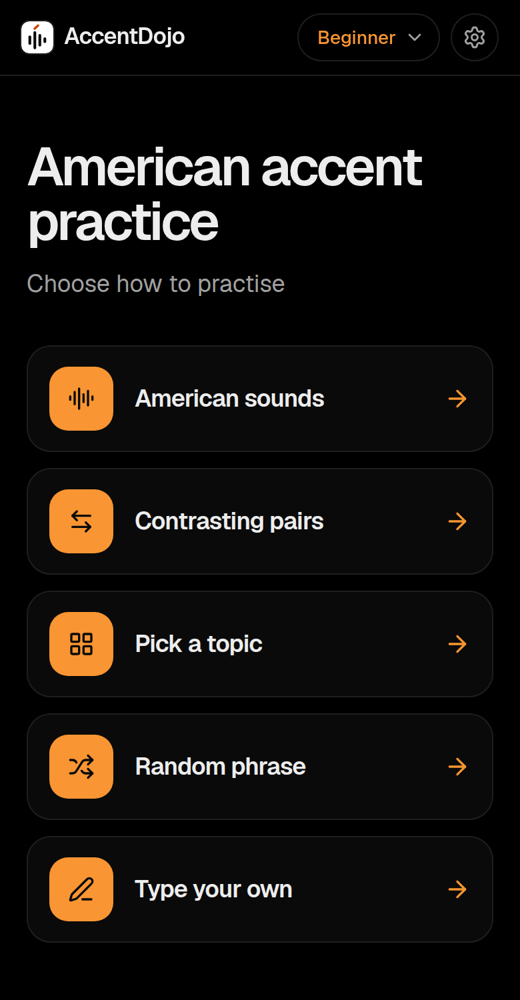

# Accent Dojo

An app for practising an American accent. It plays a phrase in an American voice, you say
it back, and it gives you a score from 0 to 100 and shows which words and sounds to fix.

You can run it on your own computer, or host it on a server and use it from your phone. It
runs on an ordinary CPU.

<p>
  
  
</p>

## What you can practise

Phrases for everyday situations, word pairs like sheep and ship, each of the 47 American
sounds on its own, random phrases, or any text you type. There are three levels: beginner,
intermediate and advanced. Each sound has a short guide on how to make it.

After each try you see your score, the words you got wrong and what went wrong in each one.
A score of 100 means you sounded as clear as the app's voice. Treat the score as a rough
guide: it can be off by about 8 points and it misses some wrong sounds.

It works on phones, and you can install it on the home screen like an app.

## Install

It works on Linux and macOS. You need Python 3.10 to 3.12, Node 20.19 or newer, `ffmpeg` and
about 6 GB of free disk space. On a Mac, `brew install python@3.11 node ffmpeg` installs them.
Nobody has tried Windows yet; running the same steps inside WSL 2 should work.

```sh
# backend
cd backend
python3.11 -m venv .venv
.venv/bin/pip install --index-url https://download.pytorch.org/whl/cpu torch
.venv/bin/pip install -e '.[dev]'

# frontend, built once and served by the backend
cd ../frontend
npm install
npm run build

# run
cd ../backend
.venv/bin/uvicorn accentdojo.app:app --host 127.0.0.1 --port 8000
```

Then open http://127.0.0.1:8000. The first start downloads about 2.7 GB of models and then
spends about 45 minutes on a 12-core CPU preparing the voice for every phrase. You can
practise while it works.

## Use it from your phone

Browsers only let a page use the microphone on `localhost` or over HTTPS. To use the app from
another device, put an HTTPS proxy such as Caddy, nginx or `tailscale serve` in front of port
8000, and set `ACCENTDOJO_PASSWORD` so that strangers can't use it.

There is an example systemd unit in `deploy/accentdojo-backend.service`. It expects the code in
`~/gh/accentdojo` and won't download anything, so start the backend by hand once before you
enable it.

These environment variables are all optional:

| Variable | Default | What it does |
|---|---|---|
| `ACCENTDOJO_PASSWORD` | unset | Shared password. Changing it signs everyone out. |
| `ACCENTDOJO_KEEP_TAKES` | off | `1` saves each recording and its result in `backend/.cache/takes/`. Otherwise recordings are deleted after scoring. |
| `ACCENTDOJO_VOICE` | `af_heart` | Kokoro voice used for the phrases. |
| `ACCENTDOJO_TORCH_THREADS` | `6` | Number of CPU threads. |
| `VITE_SOURCE_URL` | this repository | Source link shown in Settings, set when you build. If you change the code, point it at your copy (see Licence). |

## Development

```sh
(cd backend  && .venv/bin/python -m pytest -q && .venv/bin/ruff check .)   # no models needed
(cd frontend && npx tsc -b && npx oxlint src)
(cd frontend && VITE_API=mock npm run dev)   # the UI with a fake backend and made-up scores
```

Claude Code, an AI coding agent, wrote most of the code and all of the phrases. I designed
the app and the scoring, tested it on my own voice and reviewed the changes.

If the app marks a word wrong when it was right, or misses a mistake, please open an issue.
Please also open one before you send a big pull request.

## Licence

Copyright (C) 2026 Ilia Kolesnikov.

The code is under [AGPL-3.0-or-later](LICENSE) because the scoring uses
[OpenPronounce](https://github.com/OpenPronounce/OpenPronounce), which is AGPL. If you run a
changed version for other people, you have to give them your source code.

The phrases in `content/` are [CC0 1.0](content/LICENSE).

Licences for other software, models and fonts are in
[THIRD_PARTY_LICENSES.md](THIRD_PARTY_LICENSES.md).
