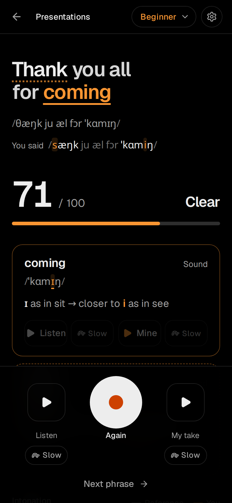

# Accent Dojo

An app for practicing an American accent. It plays a phrase in an American voice. You say
the phrase back. Then the app gives you a score from 0 to 100 and shows the words and sounds
to fix.

You can run it on your own computer, or host it on a server and use it from your phone. It
runs on an ordinary CPU.

I built it for myself and my family. If you want to change or add something, you are
welcome to do it (see Development).

<p>
  
  
</p>

## What you can practice

You can practice in five ways:

- Phrases for everyday situations
- Word pairs, like "sheep" and "ship"
- Each of the 47 American sounds alone
- Random phrases
- Any text that you type

There are three levels: beginner, intermediate and advanced. Each sound has a short guide on
how to make it.

After each try you see your score, the words you got wrong and what went wrong in each one.
A score of 100 means you sounded as clear as the app's voice. The score is not exact. It can
be wrong by about 8 points, and it does not find all wrong sounds.

It works on phones. You can add it to the home screen of your phone.

## Install

It works on Linux and macOS. You need Python 3.10 to 3.12, Node 20.19 or newer, `ffmpeg` and
about 6 GB of free disk space. On a Mac, `brew install python@3.11 node ffmpeg` installs them.
I did not test Windows. The same steps can work in WSL 2, but I did not try
it.

```sh
# backend
cd backend
python3.11 -m venv .venv
.venv/bin/pip install --index-url https://download.pytorch.org/whl/cpu torch
.venv/bin/pip install -e '.[dev]'

# frontend, built once and served by the backend
cd ../frontend
npm install
npm run build

# run
cd ../backend
.venv/bin/uvicorn accentdojo.app:app --host 127.0.0.1 --port 8000
```

Then open http://127.0.0.1:8000. When you start the app the first time, it downloads about
2.7 GB of models. Then it makes the audio for every phrase. This takes about 45 minutes on a
12-core CPU. You can practice while it works.

## Use it from your phone

Browsers only let a page use the microphone over HTTPS, or on `localhost`. To use the app
from your phone, do these steps:

1. Put an HTTPS proxy in front of port 8000, for example Caddy, nginx or Tailscale.
2. Set `ACCENTDOJO_PASSWORD`. Other people cannot use the app without it.

## Run it all the time

`deploy/accentdojo-backend.service` is an example systemd unit. It expects the code in
`~/gh/accentdojo`. It does not download the models. Start the backend by hand one time before you enable the unit.

These environment variables are all optional:

| Variable | Default | What it does |
|---|---|---|
| `ACCENTDOJO_PASSWORD` | unset | Shared password. If you change it, everyone must sign in again. |
| `ACCENTDOJO_KEEP_TAKES` | off | `1` saves each recording and its result in `backend/.cache/takes/`. If it is off, the app deletes each recording after it gives the score. |
| `ACCENTDOJO_VOICE` | `af_heart` | Kokoro voice used for the phrases. |
| `ACCENTDOJO_TORCH_THREADS` | `6` | Number of CPU threads. |
| `VITE_SOURCE_URL` | this repository | The link to the source code in Settings. Set it before you build the frontend. If you change the code, point it at your copy (see License). |

## Development

```sh
(cd backend  && .venv/bin/python -m pytest -q && .venv/bin/ruff check .)   # no models needed
(cd frontend && npx tsc -b && npx oxlint src)
(cd frontend && VITE_API=mock npm run dev)   # the UI with a fake backend and made-up scores
```

Claude Code wrote most of the code and all of the phrases. I designed
the app and the scoring, tested it on my own voice and reviewed the changes.

Changes are welcome. For a small fix, send a pull request. For a big change, open an issue
first, so that we can talk about it. If the app marks a word wrong when it was right, or
misses a mistake, please open an issue too.

## License

Copyright (C) 2026 Ilia Kolesnikov.

The code is under [AGPL-3.0-or-later](LICENSE) because the scoring uses
[OpenPronounce](https://github.com/OpenPronounce/OpenPronounce), which is AGPL. If you run a
changed version for other people, you have to give them your source code.

The phrases in `content/` are [CC0 1.0](content/LICENSE).

Licenses for other software, models and fonts are in
[THIRD_PARTY_LICENSES.md](THIRD_PARTY_LICENSES.md).
